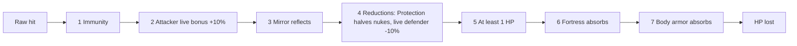
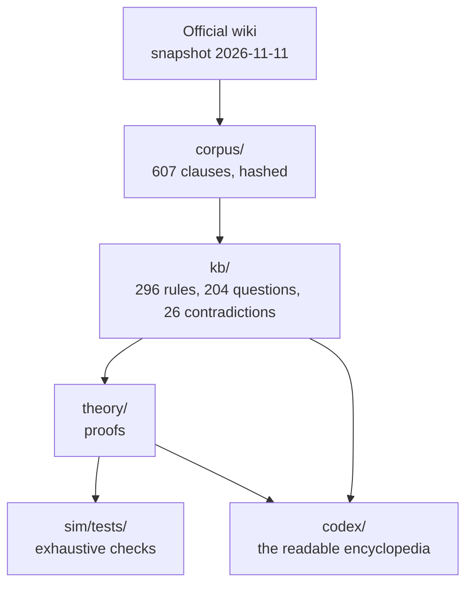

<div align="center">

# Safe Zone Codex

**Every sentence of a rulebook hides a formula. We find them, prove what follows, and say plainly what nobody knows yet.**


</div>

---

## In one minute

**Safe Zone** is a real-world survival event hosted by streamer Ice Poseidon. Streamers walk around a real city with a phone that reports their GPS position. They must stay inside a moving circle, the "safe zone", chosen live by the host. Viewers pay to send missiles, zombies and gas at them; contestants fight each other with weapons, items and magical "sigils". The last one standing wins $50,000.

There is no game to download and take apart. **The game, as far as anyone outside can know it, is its rulebook**: a wiki of about 600 short English sentences.

This project reads that wiki the way a mathematician reads a contract.

---

## The thesis

> A rulebook written in plain English is not a description of a game. It is a compressed program, and like every compressed program it has bugs, gaps and consequences its authors never wrote down.

Three claims follow, and the whole repository exists to test them.

### 1. Every sentence hides a formal rule

Take one line from the damage page:

> "Being live on Kick then takes off 10%, rounded down."

It sounds precise. It is not. "Rounded down" can apply to the damage you receive, or to the 10% that is taken off. For a 5 HP hit:

| Reading | Formula | 5 HP hit becomes |
|---|---|---|
| A: round the result | $\lfloor 9d/10 \rfloor$ | **4** |
| B: round the 10% removed | $d - \lfloor d/10 \rfloor$ | **5** |

We proved (theorem T-0002) that the two readings differ by exactly 1 HP on every hit that is not a multiple of 10. So the wiki's promise "you take 10% less damage" is worth either *about 1 HP off almost every small hit* or *nothing at all on small hits*. One frame of one stream would settle it. Until then, both readings stay in every model.

### 2. Every rule interacts with others, and the interactions are where the surprises are

The wiki lists seven steps every hit goes through, in order:



Chain them and things fall out that no single sentence says:

- **The live-streaming attack bonus does nothing to weak weapons.** "+10%, rounded down" adds $\lfloor d/10 \rfloor$, which is zero for every hit under 10 HP. Bows, knives and fake chests (5 HP each) are unaffected. *(T-0001, proven for every value.)*
- **A fortress and body armor behave like one shared pool.** Under the natural reading, they absorb the first 45 HP of damage no matter how it arrives: one big hit or forty-five tiny ones. *(T-0007.)*
- **Poison can cancel itself.** "Getting poisoned again resets the timer." If that timer is the clock to the next tick, then re-poisoning someone every 89 seconds or less means they **never take poison damage**. A weapon, used eagerly, becomes a shield. *(T-0009, conditional on how the reset works.)*

### 3. What cannot be derived must be named, not guessed

The previous attempt at analysing this game (a chatbot conversation) produced a confident tier list with zero computation, and credited the wrong sigil with a healing power. This project's rule is the opposite: **no number is invented**. When the wiki is silent, the gap becomes an open question with a name, a priority, and the observation that would close it.

There are **204** of them today. Five are critical, for example:

| Question | Why it matters |
|---|---|
| How many contestants, for how long? | Every "who wins" model depends on it. |
| What do viewer attacks cost? | The wiki never says, so "damage per dollar" cannot be computed yet. |
| Which damage counts as a "hit"? | Decides whether armor stops zombie bites and zone ticks. |

---

## How we keep ourselves honest

Every statement in this repository carries exactly one label:

| Label | Meaning |
|---|---|
| `DOCUMENTED` | The wiki says it, quoted word for word with a link. |
| `DERIVED` | It follows mathematically from documented rules, with a proof and a test. |
| `CONDITIONAL` | It follows, but only under one named reading of an open question. |
| `HYPOTHESIS` | Plausible, unproven, with the experiment that would decide it. |
| `CONTRADICTED` | Two pages of the wiki disagree. We found 26 such cases. |
| `UNKNOWN` | Nobody outside the organizers can know yet. |

And three machines check the humans:

- `tools/check_kb.py` refuses any quote that is not a **verbatim** substring of the wiki text, and any rule from an outdated snapshot.
- `sim/tests/` turns each theorem into a test that checks **every** possible value (or one full period of a periodic formula, which is a proof).
- Each test was broken on purpose once to make sure it actually fails when it should.

---

## Results so far, in plain words

| Finding | Label |
|---|---|
| Being live on Kick gives no attack bonus on hits of 9 HP or less. | `DERIVED` |
| The defensive "10% less damage" means 1 HP off small hits, or nothing, depending on an unwritten rounding. | `CONDITIONAL` |
| Leaving the zone at 100 HP kills you in 203 or 205 seconds (the wiki does not say when the first tick lands). | `CONDITIONAL` |
| A zombie drains its maximum 30 HP in 5 minutes; a guard zombie in 75 seconds. | `CONDITIONAL` |
| Healing's passive regeneration is worth at most 48 HP a day. | `CONDITIONAL` |
| Max HP from 100 to 200 costs 850 blood tokens; for Ingenuity, 935, or 939 if the server uses floating-point maths. | `DERIVED` / `HYPOTHESIS` |
| Because HP is capped, death is mathematically certain in the long run, but can take longer than the age of the universe. The useful question is survival over the event's real duration. | `DERIVED` |
| Testing "10% chance" on Eddie's potion needs about 253 to 270 observed drinks. Public streams will rarely provide that many. | `DERIVED` |

---

## Map of the repository



| Folder | What you will find |
|---|---|
| [`codex/`](codex/) | **Start here.** One page per [sigil](codex/sigils/), per [rule family](codex/rules/), per [theorem](codex/theorems/), and [every open question](codex/unknowns.md). |
| [`theory/`](theory/) | The mathematics, written for a reader with high-school maths. |
| [`kb/`](kb/) | The machine-readable knowledge base (one YAML file per rule). |
| [`corpus/`](corpus/) | The wiki text, split sentence by sentence, with hashes and sources. |
| [`re/findings/`](re/findings/) | What the website's own code reveals (short answer: no hidden game data). |
| [`sim/`](sim/) | Exact arithmetic and the tests behind every theorem. |

---

## Still to come

- Theory of healing, Eddie's gamble potion, the blood-token economy, zombies, and sigil choice as a game between players.
- A simulator that plays out whole events under every reading of every open question, with confidence intervals.
- Tier lists that say how sure they are, and a viewer guide to damage per Cx-Buck once prices are known.

## Reproduce everything

```
py -3 -m venv .venv
.venv\Scripts\python -m pip install numpy scipy pyyaml jsonschema pytest hypothesis matplotlib
.venv\Scripts\python -m pytest sim -q
.venv\Scripts\python tools\check_kb.py --coverage
.venv\Scripts\python tools\build_codex.py
```

## Scope and ethics

Only public wiki pages are read, at one request per second. No game API is ever called. No contestant's location is collected, stored or derived. Rules from the earlier October 2026 edition are kept as history only. The rule text belongs to its authors and is quoted with its source and date. Full rules: [`SCOPE.md`](SCOPE.md). This project is independent and not endorsed by the event's organizers.
