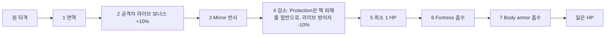
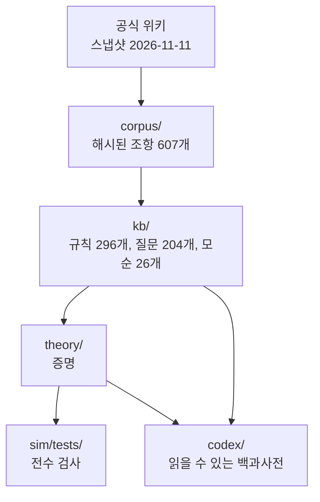

<div align="center">

# Safe Zone Codex

[English](../README.md) | 한국어

**규칙서의 모든 문장에는 공식이 숨어 있습니다. 우리는 그 공식을 찾아내고, 거기서 무엇이 따라 나오는지 증명하며, 아직 아무도 모르는 것은 분명하게 모른다고 말합니다.**


</div>

---

## 1분 요약

**Safe Zone**(세이프 존)은 스트리머 Ice Poseidon이 진행하는 실제 도시 생존 이벤트입니다. 스트리머들은 GPS 위치를 보고하는 휴대폰을 들고 실제 도시를 걸어 다닙니다. 진행자가 실시간으로 정하는 움직이는 원, 곧 "세이프 존" 안에 머물러야 합니다. 시청자는 비용을 내고 미사일, 좀비, 가스를 보내 공격하며, 참가자들은 무기, 아이템, 마법의 "시길"(sigil)로 서로 싸웁니다. 마지막까지 살아남은 사람이 $50,000를 받습니다.

내려받아 뜯어볼 수 있는 게임은 없습니다. **외부 사람이 알 수 있는 한, 이 게임은 곧 규칙서입니다**. 약 600개의 짧은 영어 문장으로 이루어진 위키입니다.

이 프로젝트는 수학자가 계약서를 읽듯이 그 위키를 읽습니다.

---

## 명제

> 평범한 영어로 쓰인 규칙서는 게임에 대한 설명이 아닙니다. 그것은 압축된 프로그램이며, 모든 압축된 프로그램이 그렇듯 버그와 빈틈, 그리고 작성자가 적어 두지 않은 결과를 가지고 있습니다.

여기서 세 가지 주장이 따라 나오며, 이 저장소 전체는 그 주장들을 검증하기 위해 존재합니다.

### 1. 모든 문장에는 형식 규칙이 숨어 있습니다

피해 페이지의 한 줄을 예로 들겠습니다.

> "Being live on Kick then takes off 10%, rounded down."

(Kick 라이브 중이면 그다음에 10%가 차감되며, 내림합니다.)

정확해 보이지만 그렇지 않습니다. "내림"은 받는 피해에 적용될 수도 있고, 차감되는 10%에 적용될 수도 있습니다. 5 HP 타격을 예로 들면 다음과 같습니다.

| 해석 | 공식 | 5 HP 타격의 결과 |
|---|---|---|
| A: 결과를 내림 | $\lfloor 9d/10 \rfloor$ | **4** |
| B: 차감되는 10%를 내림 | $d - \lfloor d/10 \rfloor$ | **5** |

우리는 (정리 [T-0002](codex/theorems/T-0002.md)) 10의 배수가 아닌 모든 타격에서 두 해석의 결과가 정확히 1 HP 차이 난다는 것을 증명했습니다. 따라서 "받는 피해가 10% 줄어든다"는 위키의 약속은 *거의 모든 작은 타격에서 약 1 HP를 덜어 준다*는 뜻일 수도 있고, *작은 타격에서는 아무 효과도 없다*는 뜻일 수도 있습니다. 한 스트림의 한 프레임이면 결론이 납니다. 그때까지는 모든 모델에 두 해석을 모두 남겨 둡니다.

### 2. 모든 규칙은 다른 규칙과 상호작용하며, 놀라운 일은 그 상호작용에서 나옵니다

위키는 모든 타격이 거치는 일곱 단계를 순서대로 나열합니다.



이 단계들을 이어 붙이면 어느 한 문장도 말하지 않은 결과가 나옵니다.

- **라이브 방송 공격 보너스는 약한 무기에는 아무 효과가 없습니다.** "+10%, 내림"은 $\lfloor d/10 \rfloor$를 더하는데, 이 값은 10 HP 미만의 모든 타격에서 0입니다. 활, 칼, 가짜 상자(각각 5 HP)는 영향을 받지 않습니다. *([T-0001](codex/theorems/T-0001.md), 모든 값에 대해 증명됨.)*
- **Fortress와 Body armor는 하나의 공유 풀처럼 동작합니다.** 자연스러운 해석에서는 피해가 어떤 방식으로 들어오든, 한 번의 큰 타격이든 마흔다섯 번의 작은 타격이든, 처음 45 HP의 피해를 흡수합니다. *([T-0007](codex/theorems/T-0007.md).)*
- **독은 스스로를 상쇄할 수 있습니다.** "다시 중독되면 타이머가 초기화됩니다." 그 타이머가 다음 틱까지의 시계라면, 누군가를 89초 이하 간격으로 계속 다시 중독시키면 그 사람은 **독 피해를 전혀 받지 않습니다**. 적극적으로 쓰는 무기가 방패가 됩니다. *([T-0009](codex/theorems/T-0009.md), 초기화가 어떻게 작동하는지에 따른 조건부.)*

### 3. 도출할 수 없는 것은 추측이 아니라 이름을 붙여야 합니다

이 게임을 분석하려던 이전 시도(챗봇 대화)는 계산 없이 확신에 찬 티어 리스트를 내놓았고, 엉뚱한 시길에 회복 능력이 있다고 적었습니다. 이 프로젝트의 규칙은 그 반대입니다. **어떤 숫자도 지어내지 않습니다**. 위키가 침묵하는 곳은 이름, 우선순위, 그리고 그것을 해결해 줄 관찰 내용을 갖춘 미해결 질문이 됩니다.

현재 그 질문은 **204**개입니다. 그중 다섯 개는 치명적이며, 예를 들면 다음과 같습니다.

| 질문 | 중요한 이유 |
|---|---|
| 참가자는 몇 명이고, 얼마나 오래 진행됩니까? | "누가 이기는가" 모델은 모두 이 값에 달려 있습니다. |
| 시청자의 공격에는 비용이 얼마나 듭니까? | 위키에 나와 있지 않으므로 "달러당 피해"는 아직 계산할 수 없습니다. |
| 어떤 피해가 "타격"으로 계산됩니까? | 방어구가 좀비의 물기와 존 틱을 막는지를 좌우합니다. |

---

## 스스로를 정직하게 지키는 방법

이 저장소의 모든 진술에는 정확히 하나의 라벨이 붙습니다.

| 라벨 | 의미 |
|---|---|
| `DOCUMENTED` | 위키가 그렇게 말하며, 링크와 함께 한 글자도 바꾸지 않고 인용합니다. |
| `DERIVED` | 문서화된 규칙에서 수학적으로 따라 나오며, 증명과 테스트가 있습니다. |
| `CONDITIONAL` | 따라 나오기는 하지만, 미해결 질문에 대한 이름 붙은 하나의 해석 아래에서만 그렇습니다. |
| `HYPOTHESIS` | 그럴듯하지만 증명되지 않았으며, 이를 가려낼 실험이 함께 적혀 있습니다. |
| `CONTRADICTED` | 위키의 두 페이지가 서로 어긋납니다. 이런 경우를 26건 찾았습니다. |
| `UNKNOWN` | 아직 주최 측 외에는 아무도 알 수 없습니다. |

그리고 세 개의 기계가 사람을 검사합니다.

- `tools/check_kb.py`는 위키 본문의 **원문 그대로의** 부분 문자열이 아닌 인용, 그리고 오래된 스냅샷의 규칙을 모두 거부합니다.
- `sim/tests/`는 각 정리를 **모든** 가능한 값(또는 주기 공식의 한 주기 전체이며, 이것이 곧 증명입니다)을 검사하는 테스트로 바꿉니다.
- 새로운 적대적 검토자가 모든 정리를 공격했습니다. 14개 중 8개는 유지되었고 6개는 깨졌으며, 같은 날 수정되었습니다. 수정본은 두 번째 검토를 기다리고 있습니다([`theory/`](theory/) 참조). 숨기는 것은 없습니다.

---

## 지금까지의 결과, 쉬운 말로

| 발견 | 라벨 |
|---|---|
| Kick 라이브 중이어도 9 HP 이하의 타격에는 공격 보너스가 없습니다. | `DERIVED` |
| 방어 쪽 "피해 10% 감소"는 적혀 있지 않은 반올림 방식에 따라 작은 타격에서 1 HP를 덜어 주거나 아무것도 덜어 주지 않습니다. | `CONDITIONAL` |
| 100 HP에서 존을 벗어나면 203초 또는 205초 만에 죽습니다(위키는 첫 틱이 언제 들어오는지 말하지 않습니다). | `CONDITIONAL` |
| 좀비는 최대 30 HP를 5분 만에 소진시키고, 가드 좀비는 75초 만에 소진시킵니다. | `CONDITIONAL` |
| 회복의 패시브 재생은 하루 최대 48 HP의 가치가 있습니다. | `CONDITIONAL` |
| 최대 HP를 100에서 200으로 올리는 데 블러드 토큰 850개가 듭니다. Ingenuity는 935개, 서버가 부동소수점 연산을 쓰면 939개입니다. | `DERIVED` / `HYPOTHESIS` |
| HP에 상한이 있으므로 장기적으로 죽음은 수학적으로 확실하지만, 우주의 나이보다 오래 걸릴 수 있습니다. 쓸모 있는 질문은 이벤트의 실제 진행 시간 동안의 생존입니다. | `DERIVED` |
| Eddie의 물약에서 "10% 확률"을 검증하려면 약 253회에서 270회의 음용 관찰이 필요합니다. 공개 스트림에서 그만큼 얻기는 어렵습니다. | `DERIVED` |

---

## 저장소 지도



| 폴더 | 들어 있는 것 |
|---|---|
| [`codex/`](codex/index.md) | **여기서 시작하십시오: [전체 색인](codex/index.md).** [시길](codex/sigils/)별, [규칙 계열](codex/rules/)별, [정리](codex/theorems/)별 페이지가 하나씩 있고, [모든 미해결 질문](codex/unknowns.md)도 있습니다. |
| [`theory/`](theory/) | 고등학교 수학을 아는 독자를 위해 쓴 수학 부분입니다. |
| [`kb/`](../kb/) | 기계가 읽을 수 있는 지식 베이스입니다(규칙당 YAML 파일 하나). |
| [`corpus/`](../corpus/) | 위키 본문을 문장 단위로 나누고 해시와 출처를 붙인 것입니다. |
| [`re/findings/`](../re/findings/) | 웹사이트 자체 코드가 드러내는 것입니다(짧게 말하면, 숨겨진 게임 데이터는 없습니다). |
| [`sim/`](../sim/) | 정확한 산술과 모든 정리 뒤에 있는 테스트입니다. |

---

## 앞으로 할 일

- 회복, Eddie의 도박 물약, 블러드 토큰 경제, 좀비, 그리고 플레이어 간 게임으로서의 시길 선택에 관한 이론.
- 모든 미해결 질문의 모든 해석 아래에서 이벤트 전체를 진행해 보고 신뢰구간을 내는 시뮬레이터.
- 얼마나 확신하는지를 함께 말해 주는 티어 리스트, 그리고 가격이 알려진 뒤의 Cx-Buck당 피해 시청자 가이드.

## 모든 것을 재현하기

```
py -3 -m venv .venv
.venv\Scripts\python -m pip install numpy scipy pyyaml jsonschema pytest hypothesis matplotlib
.venv\Scripts\python -m pytest sim -q
.venv\Scripts\python tools\check_kb.py --coverage
.venv\Scripts\python tools\build_codex.py
```

## 범위와 윤리

공개된 위키 페이지만 초당 한 번의 요청으로 읽습니다. 게임 API는 호출하지 않습니다. 어떤 참가자의 위치도 수집, 저장, 도출하지 않습니다. 이전 2026년 10월판의 규칙은 기록으로만 보존합니다. 규칙 본문의 저작권은 작성자에게 있으며, 출처와 날짜를 밝혀 인용합니다. 전체 규칙: [`SCOPE.md`](../SCOPE.md). 이 프로젝트는 독립적이며 이벤트 주최 측의 승인을 받지 않았습니다.
